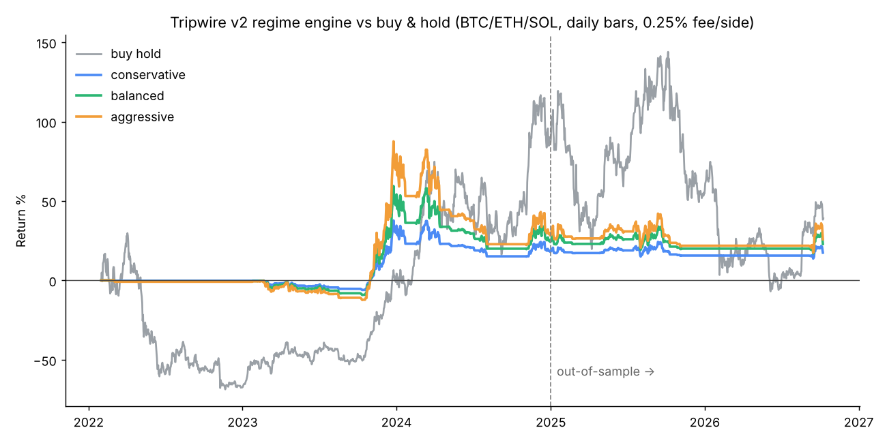

# Tripwire

**Set your risk. Fund it. AI trades for you, switching between 3 trading "brains" to fit the market, with a Rust safety layer it can't override.**

Hacklanta '26 · Fintech track · paper trading on live crypto · not financial advice.

## The problem
- Investing well is technical *and* emotional. Most people panic-sell the bottom and buy the top.
- Robinhood gives you a buy button. Robo-advisors park your money and never react. Bots run one strategy until it breaks.
- Nothing trades *for* a regular person, adapts to the market, controls risk, and explains itself.

## How it works
| Market | Brain | What it does |
|---|---|---|
| Calm | Mean-Reversion | buys sharp dips, sells the bounce |
| Trending up | Trend | rides it, sized by volatility |
| Volatile | Breakout | buys confirmed breakouts, tight trailing stop |
| Falling | Shield | holds cash until the market turns |

**The AI picks the brain. Rust checks every order.** The AI can tighten your limits but never loosen them.

**Don't trust our track record, verify it.** Every trade, AI decision and blocked order is SHA-256 hash-chained and the chain head is written to Solana every 5 minutes. The Proof tab recomputes the chain in your browser and checks it against the blockchain.

## Results (real backtest, fees included)
| | Tripwire (conservative) | Buy & hold |
|---|---|---|
| 2025–26 (held out) | **+0.4%** | **−27.5%** |
| Worst drop, 2022–26 | **−17%** | **−76%** |


Small sample (98 trades). It lags in strong bull runs; it's built to protect. Details: `docs/02_BACKTEST.md`.

## Repo map
| Folder | What | Owner |
|---|---|---|
| `engine/` | Rust: indicators, regime, brains, risk gate, execution, API | Owner |
| `data/` `backtest/` | market data, fixtures, replays, backtest | B · Data |
| `agents/` `mcp/` | AI agents, Solana anchoring, MCP server | C · AI & MCP |
| `web/` `landing/` | dashboard + public site | D · Product |
| `docs/` | idea, spec, plan, prompts | everyone |

## Run it locally (2 terminals)
```bash
cp .env.example .env                       # engine, agents and MCP all read this file; DEV=1 works with no keys
cd web && npm install && npm run build     # dashboard
cd ../engine && DEV=1 DATA_DIR=../data cargo run --release   # http://localhost:8080
# AI agents: cd agents && pip install -r requirements.txt && python worker.py   (no key = rule-based mode; ANTHROPIC_API_KEY in .env = Claude)
# optional: MCP for Claude Desktop               cd mcp && pip install -r requirements.txt  (config on the "Talk to Claude" tab)
```
Stock replay data (needs Alpaca keys): `python data/fetch_stocks.py`.
Tests: `cd engine && cargo test` (risk-gate codes, tighten-only limits, AI override, **Rust-vs-Python parity** on 1,700 days of BTC).
Deploy: `docker compose -f deploy/docker-compose.yml up -d --build`.

## Team
| Name | Seat | GitHub |
|---|---|---|
| AJ (Olatokunbo Ajayi) | Owner · Engine | @tokunboajayi |
| Bryant Awoh | B · Data & Strategy | @Bawoh1 |
| Ebere | C · AI & MCP | @ubaniebereo |
| Kelly Awoh | D · Product | @kellyawoh-jpg |

Paper trading only. Not financial advice.
