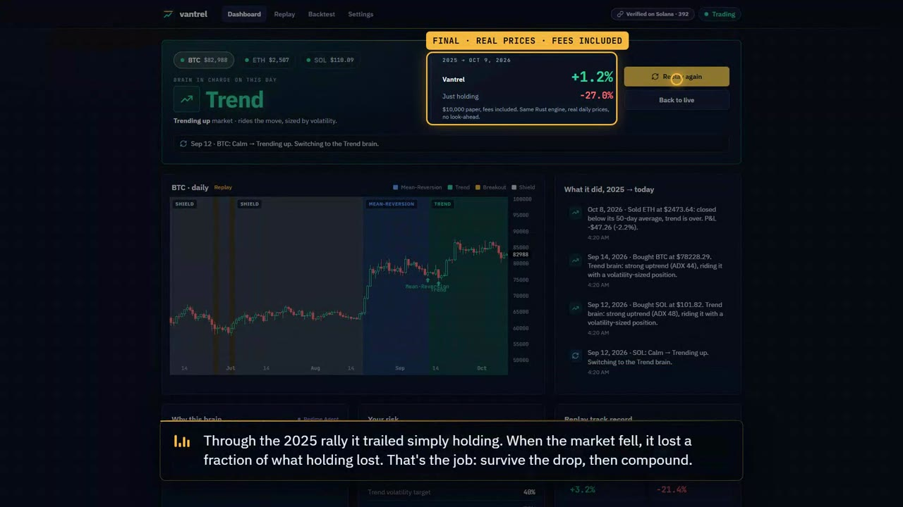

# Vantrel

**Set your risk. Fund it. AI trades for you, switching between 3 trading "brains" (plus a cash Shield) to fit the market, with a Rust safety layer it can't override.**

**Live: [https://getwiththeprogram.study](https://getwiththeprogram.study)** · Hacklanta '26 · Fintech track · paper trading on live crypto · not financial advice.

## Demo (98 s, narrated)
[](demo/vantrel-demo.mp4)

▶ [Watch the demo](demo/vantrel-demo.mp4) · [download (mp4)](https://github.com/tokunboajayi/tripwire/raw/main/demo/vantrel-demo.mp4). Recorded from the live app, narrated with ElevenLabs. Rebuild it with one command: `demo/video/`.

> **Through 2025 into 2026, crypto fell 28%. Vantrel finished up 1%. The AI picks the strategy. Rust holds the line.**

## The problem
- Investing well is technical *and* emotional. Most people panic-sell the bottom and buy the top.
- Robinhood gives you a buy button. Robo-advisors park your money and never react. Bots run one strategy until it breaks.
- Nothing trades *for* a regular person, adapts to the market, controls risk, and explains itself.

## How it works
| Market | Brain | What it does |
|---|---|---|
| Calm | Mean-Reversion | buys sharp dips, sells the bounce |
| Trending up | Trend | rides it, sized by volatility |
| Volatile | Breakout | buys confirmed breakouts, tight trailing stop |
| Falling | Shield | holds cash until the market turns |

**The AI (Claude) picks the brain. Rust checks every order.**
- **Hard limits:** your risk per trade, max exposure and daily-loss pause line are enforced in Rust. Any order outside them is blocked with a reason code.
- **Earned risk:** the AI can always tighten your limits. It can only ask to raise them back toward the ceiling *you* set, and only after it has earned it: 3+ trades in 30 days, 55%+ wins, not losing today, and at most +25% per step. Otherwise Rust answers `RISK_NOT_EARNED`, `RISK_STEP_TOO_BIG` or `LIMIT_LOOSEN_DENIED`.
- **Explains itself:** every trade, brain switch and blocked order comes with a one-line reason, in text and (optionally) spoken by ElevenLabs.

**Don't trust our track record, verify it.** Every trade, AI decision and blocked order is SHA-256 hash-chained, and the chain head is written to Solana every 5 minutes. Settings → *Verify the track record* recomputes the chain in your browser and checks it against the blockchain.

## Results (real prices, fees included)
| | Vantrel | Buy & hold |
|---|---|---|
| **Live replay, Jan 2025 → Oct 2026** (in the app, same engine) | **+1.2%** | **−27.8%** |
| Backtest 2025–26, held out (conservative) | **+0.4%** | **−27.5%** |
| Worst drop, 2022–26 | **−17%** | **−76%** |


Small sample (98 trades in the backtest). It lags in strong bull runs; it's built to protect. Details: `docs/02_BACKTEST.md`.

## What you can try on the live site
1. **Get started:** type a name (guest sign-in: a private random id per browser, no password) or use Auth0 if it's configured.
2. **Pick your risk** with the slider, set a goal, fund $10,000 of paper money.
3. **Dashboard:** live BTC/ETH/SOL, the brain in charge and why, the risk wire with the auto-pause line, TradingView charts.
4. **Watch it survive 2025:** a narrated replay of 2025 → today on real daily prices, Vantrel vs just holding.
5. **Ask the AI to raise its risk:** see Rust refuse until it's earned.
6. **Settings:** verify the Solana-anchored track record, test the voice, connect Claude Desktop via MCP ("talk to your portfolio").

## Built with
| Tech | Used for |
|---|---|
| **Rust** (axum, tokio) | engine: indicators, regime, brains, risk gate, ledger, API, live stream |
| **Claude** (Anthropic) | regime agent and trade explanations; falls back to rule-based mode with no key |
| **ElevenLabs** | spoken alerts and the narrated replay (one voice at a time, cached) |
| **Solana** | track-record anchoring (hash-chain head every 5 min) |
| **Auth0** | sign-in (optional; guest sign-in works alongside it) |
| **TradingView** | lightweight-charts in the app; `tv-mcp/` gives the AI read-only eyes on a TradingView chart |
| **MCP** | `mcp/`: ask Claude about your portfolio; it cannot place orders |
| React + Vite, Python, Playwright, Docker, Caddy | web, agents, UI tests, deploy |

## Repo map
| Folder | What | Owner |
|---|---|---|
| `engine/` | Rust: indicators, regime, brains, risk gate, execution, API | Owner |
| `data/` `backtest/` | market data, fixtures, replays, backtest | B · Data |
| `agents/` `mcp/` `tv-mcp/` | AI agents, Solana anchoring, MCP servers | C · AI & MCP |
| `web/` `landing/` | dashboard + public site | D · Product |
| `demo/` | the demo video, poster, and the script that builds it (`demo/video/`) | D · Product |
| `tests/` | end-to-end and Playwright UI tests | everyone |
| `docs/` | idea, spec, plan, prompts | everyone |

### Engine modules (`engine/src/`, spec §2)
| Layer | Module | Job |
|---|---|---|
| Data | `market.rs` · `indicators.rs` | daily candles (live, offline fallback) · ATR/EMA/SMA/ADX/RSI2/Donchian/vol, parity-tested vs Python |
| Brain | `regime.rs` · `brains.rs` | deterministic regime + AI acceptance (`REGIME_MISMATCH`) · entries, exits, sizing, the one-line why |
| Safety | `risk.rs` | pure risk gate, every code unit-tested; agents tighten freely, loosen only when earned |
| Money | `ledger.rs` · `executor.rs` | accounts, positions, round trips · Alpaca paper mirror |
| Loop | `scheduler.rs` · `replay.rs` | 60s live tick · same brains on history, no look-ahead |
| API | `routes/` · `sse.rs` · `auth.rs` | spec §9 endpoints · live stream · Auth0 / guest / MCP / internal tokens |
| Trust | `audit.rs` | SHA-256 hash chain anchored on Solana |

### Web (`web/src/`, spec §10)
`/` landing · `/onboard` risk slider → goal → fund · `/app` dashboard + narrated replay · `/replay` · `/backtest` · `/settings` (verify, voice, MCP).

## Run it locally
```bash
cp .env.example .env                       # engine, agents and MCP all read this file; DEV=1 works with no keys
cd web && npm install && npm run build     # dashboard
cd ../engine && DEV=1 DATA_DIR=../data cargo run --release   # http://localhost:8080
# AI agents: cd agents && pip install -r requirements.txt && python worker.py   (no key = rule-based mode; ANTHROPIC_API_KEY in .env = Claude)
# voice: ELEVENLABS_API_KEY in .env, then Settings → Voice → Test
# optional: MCP for Claude Desktop               cd mcp && pip install -r requirements.txt  (config on the Settings page)
```
Stock replay data (needs Alpaca keys): `python data/fetch_stocks.py`. Keys never go in the repo: `.env` only.

## Tests (all run in CI on every PR)
| Suite | Command | What it proves |
|---|---|---|
| Engine | `cd engine && cargo test --release` | risk-gate codes, earned-risk rules, AI override, **Rust-vs-Python parity** on 1,700 days of BTC |
| Web | `cd web && npm run build` | TypeScript typecheck + production build |
| TradingView MCP | `cd tv-mcp && pytest -q` | regime classifier, read-only bridge |
| End to end | `python tests/e2e.py .` | API, risk gate, agent routes, SSE, replay, agents, MCP servers against a real engine |
| Live feed + voice | `python tests/live_feed.py <engine>` | live prices, SSE stream, ElevenLabs error passthrough |
| Public sign-in | `python tests/public_signin.py <engine>` | production config (no DEV): guest ids work, dev/bare-name tokens refused |
| UI (Playwright) | `cd tests/ui && npm ci && node journey.mjs` (+ `reload`, `voice`, `narration`, `auth0`) | real browser: sign up, refresh/deep links, single-voice playback, narrated replay, Auth0 mode |

## Deploy
```bash
cd ~/tripwire && git pull && docker compose --env-file .env -f deploy/docker-compose.yml --profile https up -d --build
```
Server setup and Auth0 notes: `deploy/README.md`.

## Team
| Name | Seat | GitHub |
|---|---|---|
| AJ (Olatokunbo Ajayi) | Owner · Engine | @tokunboajayi |
| Bryant Awoh | B · Data & Strategy | @Bawoh1 |
| Ebere | C · AI & MCP | @ubaniebereo |
| Kelly Awoh | D · Product | @kellyawoh-jpg |

Paper trading only. Not financial advice.
